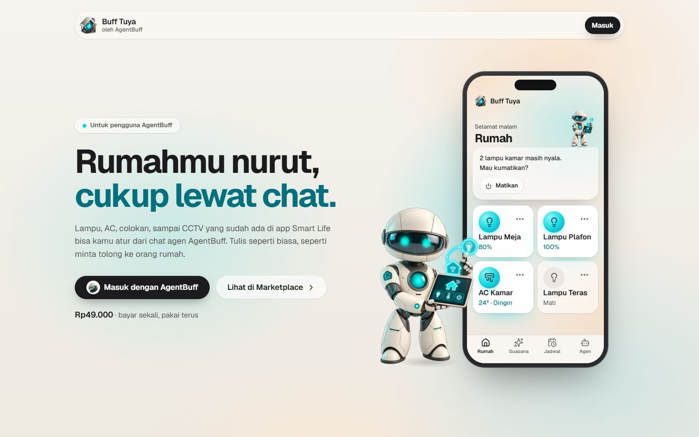

<!-- Showcase repository: the product is real and in use, its source code is private. -->

<a href="https://tuya.agentbuff.id"><picture><source media="(prefers-color-scheme: dark)" srcset="assets/banner-dark.svg"></picture></a>

<a href="https://tuya.agentbuff.id"><b>Open tuya.agentbuff.id</b></a> · <a href="https://github.com/nugrahalabib">More of my work</a> · <a href="https://nugrahalabib.com">nugrahalabib.com</a> · <a href="mailto:nugrahalabib@gmail.com">Email</a>

## Overview

Smart Home for AgentBuff links a user's Tuya and Smart Life devices to their AI agent over MCP. Lights, air conditioners, plugs and cameras already in the Smart Life app can be controlled from a chat.

Existing community servers for Tuya need a developer account or only run on the home network. This one is a multi-user web service with login, built on Tuya's end-user API with a single API key.

A web app in the style of Apple Home gives a visual view of the same home.

| | |
| --- | --- |
| **Status** | Live at [tuya.agentbuff.id](https://tuya.agentbuff.id) |
| **Role** | Designed and built by Nugraha Labib Mujaddid as a first-party app on the AgentBuff marketplace. |
| **Period** | Since Oct 2026 |
| **Source** | Private. This repository presents the product; the code is not published. |

<picture><source media="(prefers-color-scheme: dark)" srcset="assets/features-dark.svg"></picture>

Features as text

- **Device control.** Switch, dim and recolor lights, set air conditioner mode and temperature, and control several devices in one call.
- **Confirmation for risky devices.** Heaters, kettles, coffee machines, garage doors and water valves only act after an explicit confirmation.
- **Scenes.** Save a group of device states as a scene and run it with one sentence. Scenes are stored on our side.
- **Schedules and timers.** Create schedules and timers that a background worker runs, then list, pause or cancel them from chat.
- **Event automations.** React to a door opening, motion or a temperature threshold, and take a camera photo as part of the action.
- **Infrared AC pairing.** Pair an infrared air conditioner from an open code library, SmartIR (MIT), converted for this app.
- **Encrypted key storage.** The Tuya key is encrypted with AES-256-GCM, and MCP tokens are stored only as hashes.
- **Sign in with AgentBuff.** Login and entitlement come from AgentBuff, and the agent connects to the app automatically after purchase.

<picture><source media="(prefers-color-scheme: dark)" srcset="assets/architecture-dark.svg"></picture>

<picture><source media="(prefers-color-scheme: dark)" srcset="assets/stack-dark.svg"></picture>

## Engineering highlights

- Requests to Tuya go through a per-user queue with exponential backoff when the API rate limits.
- Integration tests run against a fake Tuya server, so device flows are tested without real hardware.
- The Tuya region is chosen from the key itself, so users never pick a data center.
- A frozen account becomes read-only in the web app and the MCP server refuses it.

## Screens

Landing page

---

Built by [Nugraha Labib Mujaddid](https://github.com/nugrahalabib). This page describes a private codebase; questions about the product or a demo are welcome at [nugrahalabib@gmail.com](mailto:nugrahalabib@gmail.com).
